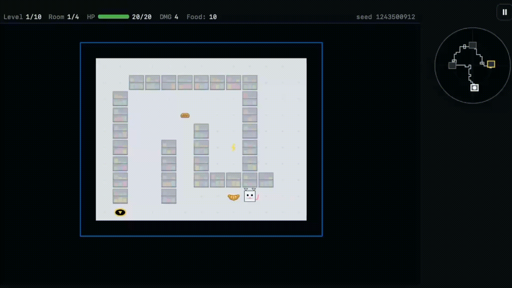
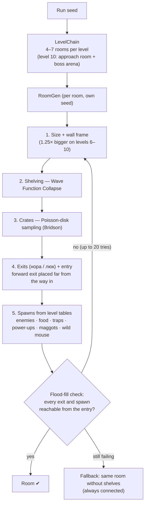

# «А Тебе?» — Mouse in the Market

> A tiny mouse sneaks through 10 shops, room by room, chasing the Big Cheese.
> Every seed is a new market.

A turn-based, top-down procedural roguelike written in TypeScript on an HTML5
Canvas. Everything is drawn in code: there are no sprite or image assets.

**▶ Play:** https://bananadigest.github.io/procedural-roguelike/

<!-- TODO: replace with a ~15-second GIF that shows 3 different dungeons (3 different seeds) -->


---

## Gameplay in one minute

- **10 shops (levels).** Each shop is a chain of 4–7 rooms, and you see one room at a time.
- **Exits.** A **нора** (mouse hole) leads to the next room of the same shop. A **люк** (manhole) leads to the next shop.
- **Fighting.** Bump into an enemy to bite it. The enemies are the cashier, the loader and the guard.
- **Pickups.**
  - Food restores HP and adds to your score.
  - A **toothpick** raises your damage.
  - An **energy drink** gives you extra moves.
  - A **maggot** hatches into a fly companion. Flies bite nearby enemies and take hits for you.
- **Hazards.** Traps appear from level 4. From level 7 a **wild mouse** may show up, and it attacks anyone. From level 8 enemies sometimes take two steps in one turn.
- **Boss.** Shop 10 ends with **the Cleaner**, who fights with a mop and throws rat poison. Beat her and the Big Cheese appears.
- **Cheese power.** When you reach the boss for the first time, the food you collected gives a one-time bonus to damage and HP.

## Controls

| Controls | Action |
| --- | --- |
| `W A S D` / arrow keys / numpad `8 4 6 2` | Move one tile; moving into an enemy attacks it |
| **Swipe** (up / down / left / right) | Move one tile; swipe into an enemy to attack (touchscreen / mobile) |
| `Esc` / Pause button `||` | Pause menu (press again to resume) |
| `M` / `Tab` / Map button `M` | Show or hide the minimap (or tap radar) |
| `R` | Start a new run with a random seed |
| Title screen | Type a seed (number or any text) and press **Start**; leave it empty for a random seed |

Debug keys, enabled while `DEBUG_LEVEL_SELECT = true` in `src/config.ts`:

| Keys | Action |
| --- | --- |
| `` ` `` | Jump to any level from 1 to 10 |
| `K` | Kill the boss instantly (level 10 arena only) |
| `G` / `H` | Preview the game-over / win screen |

## How generation works

### Determinism first

All random choices go through **Mulberry32**, a small seedable 32-bit PRNG
(`src/rng/Mulberry32.ts`). Generation code never calls `Math.random()`.
Each room gets its own derived seed:

```
roomSeed = baseSeed + level · 100 + roomIndex
```

So the same seed always produces the same shops, rooms, enemies and loot. That
lets players share a seed, and it makes bugs reproducible. A text seed is
hashed into a number first.

### Pipeline



The same diagram as plain text:

```
seed ─► LevelChain ─► room 0 ⇄нора⇄ room 1 ⇄нора⇄ … ⇄нора⇄ room N-1 ─люк─► next shop
                         │
                         ▼ RoomGen (per room)
          frame ─► WFC shelves ─► Poisson crates ─► exits/entry ─► spawns ─► flood fill ✔/↺
```

### The algorithms and why we picked them

The game avoids third-party game engines or external black-box libraries. Every procedural generation system, random stream, and reachability check is implemented from scratch using classic algorithms:

| Part | Algorithm | Implementation | Why & How It Works |
| --- | --- | --- | --- |
| **Room layout** | **Wave Function Collapse (WFC)**<br/>*(Simple Tiled Model + AC-3)* | `placeShelvesWFC` in [`src/generation/RoomGen.ts`](src/generation/RoomGen.ts) | The setting is a shop, so rooms need straight **shelf aisles**, not caves. WFC collapses tile superpositions using local adjacency rules: horizontal runs never stack and vertical runs never sit side by side. Keeps aisles walkable and procedurally diverse. |
| **Clutter & obstacles** | **Bridson's Poisson-Disk Sampling** | `placeCratesPoisson` in [`src/generation/RoomGen.ts`](src/generation/RoomGen.ts) | Crates and pallet stacks should spread evenly across the floor without clumping. Poisson-disk sampling maintains a minimum distance $r$ between points in linear $O(N)$ time via a spatial acceleration grid. |
| **Minimap corridors** | **Target-Biased Drunkard's Walk**<br/>*(Random Walk)* | `generateDrunkardCorridor` in [`src/generation/DrunkardsWalk.ts`](src/generation/DrunkardsWalk.ts) | The radar links the rooms of a shop with winding tunnels that look like organic mouse burrows. Steers random steps with a directional bias toward the target node while preventing immediate backtracking. |
| **Safety net** | **4-Directional Flood Fill (BFS)** | `floodFill` in [`src/generation/ConnectivityCheck.ts`](src/generation/ConnectivityCheck.ts) | WFC shelves and crates can occasionally block a path. Breadth-first search validates that every exit, item, and enemy is reachable from the entry; otherwise the room is rejected and regenerated (up to 20 tries). |
| **Boss poison clouds** | **Cellular Frontier Growth / Diffusion** | `generatePoisonCloudTiles` in [`src/game/PoisonCloudGen.ts`](src/game/PoisonCloudGen.ts) | The Cleaner's arsenic clouds must look like organic puffs of poison gas, never rigid squares or circles. Expands outward along neighbor frontiers within a 2×2 to 5×5 box into connected, strictly irregular blobs. |
| **Exit placement** | **Farthest-Point Selection**<br/>*(Manhattan Metric / $L_1$)* | `takeFar` in [`src/generation/RoomGen.ts`](src/generation/RoomGen.ts) | The forward exit (нора or люк) is placed as far from the entrance as possible ($|\Delta x| + |\Delta y|$), ensuring the player actually has to explore and navigate across the room. |
| **Randomness & seeds** | **Mulberry32 PRNG** | `Mulberry32` in [`src/rng/Mulberry32.ts`](src/rng/Mulberry32.ts) | Replaces `Math.random()` with a deterministic 32-bit generator (period $\approx 2^{32}$). The same seed always produces the exact same dungeon, making runs shareable and bugs reproducible. |
| **Seed text input** | **FNV-1a 32-bit Hash**<br/>*(Fowler–Noll–Vo)* | `hashSeed` in [`src/rng/Mulberry32.ts`](src/rng/Mulberry32.ts) | Converts arbitrary player-entered alphanumeric seed strings into uniform 32-bit integer seeds with fast avalanche characteristics. |
| **Spawn shuffling** | **Fisher–Yates / Knuth Shuffle** | `shuffle` in [`src/rng/Mulberry32.ts`](src/rng/Mulberry32.ts) | Permutes candidate coordinate lists and spawn queues in $O(N)$ time with zero statistical bias, guaranteeing uniform procedural variety. |
| **Loot & enemy drops** | **Roulette-Wheel Selection**<br/>*(Fitness-Proportionate)* | `weighted` in [`src/rng/Mulberry32.ts`](src/rng/Mulberry32.ts) | Samples discrete probability distributions based on cumulative weight tables. Controls food rarities, power-up chances, and level-dependent enemy mixes. |

### Architecture & Gameplay Patterns

Complementing the procedural algorithms, the game utilizes clean software engineering patterns to coordinate gameplay, AI, and graphics:

- **Two-Phase Finite State Machine (FSM):** Orchestrates Cleaner boss combat in [`src/game/Boss.ts`](src/game/Boss.ts) (Phase 1 patrol and periodic poison throws $\to$ Phase 2 enrage at $\le 50\%$ HP with rapid attacks $\to$ defeat trigger).
- **Discrete Lockstep Turn Loop:** Classic roguelike turn cycle in [`src/game/GameImpl.ts`](src/game/GameImpl.ts) resolving player actions, hazards, companion flies, and enemy AI in a strictly deterministic sequence.
- **Telegraphed Damage Grace Period:** Turn-buffered hazard timing in [`src/game/Boss.ts`](src/game/Boss.ts) granting a 1-step telegraph window when poison lands before active damage ticks begin on Step 2+.
- **Grid AI Navigation Heuristics:** Greedy Manhattan minimization for aggressive chasing (Guards, Boss) and stochastic 2D lattice wandering for passive patrol (Cashiers, Loaders) in [`src/game/Enemy.ts`](src/game/Enemy.ts).
- **Procedural Canvas Animation & Easing:** Harmonic sinusoidal wave functions (`Math.sin`) for organic idle breathing/swaying and cubic ease-out interpolation ($f(t) = 1 - (1 - t)^3$) for smooth sprite sliding between discrete tiles in [`src/render/Animator.ts`](src/render/Animator.ts).
- **Integer-Snapping Viewport Projection:** Pixel-perfect canvas scaling in [`src/render/Renderer.ts`](src/render/Renderer.ts) snapping viewport scale to whole device pixels to prevent subpixel blurring or tile seams.

Difficulty is controlled by spawn tables (`Spawns.ts`, `game/balance.ts`):
- **Enemies:** the mix and count of enemies change per level.
- **Items:** premium food appears from level 6. Toothpicks and maggots get more likely after level 7.
- **Wild mouse:** a 50% chance per room on levels 7–10.
- **Boss arena:** it has no shelves, so the boss has room to move.

To see the generator's output as text:

```bash
npm run gen -- <seed>       # print every room of a run as ASCII art
```

## Tech stack

- **TypeScript** (strict mode) and **HTML5 Canvas 2D**
- **Vite** for the dev server and the build
- **GitHub Actions → GitHub Pages:** every push to `main` is deployed automatically
- **No runtime dependencies:** the PRNG, the generators, the renderer and the animations are all hand-written

## Run locally

Requires Node.js 20 or newer.

```bash
npm install
npm run dev       # http://localhost:5173
npm run build     # type-check + production build → dist/
npm run preview   # serve the production build
```

## Project structure

```
src/
  core/        types.ts — shared contract (Room, GameState, GenerateLevel, Game) · fixtures
  rng/         Mulberry32.ts — seedable PRNG
  generation/  LevelChain · RoomGen (WFC, Poisson) · Spawns · ConnectivityCheck · DrunkardsWalk · debug
  game/        GameImpl (turn loop) · Combat · Enemy · Boss · PoisonCloudGen · Fly · WildMouse · balance
  render/      Renderer · Animator (procedural animation) · palette
  ui/          HUD · Minimap · Screens · Toast
  config.ts    tile size, viewport, room scaling, animation timings, debug flags
  main.ts      input, screen flow, render loop
```

The three parts are kept separate by the `src/core/types.ts` contract, so each
person could work on their part independently against fixtures.

## Side quests and extensions

These go beyond the core "generate a room" task:

- **Seeds you can share:** a number or any text works, and the same seed gives the same run.
- **Several generation algorithms combined:** WFC, Poisson-disk sampling, flood fill, Drunkard's Walk and random-walker clouds.
- **A boss fight with 2 phases.** In phase 2 she throws poison more often, and each cloud gives you one turn to step out before it starts hurting.
- **Fly companions:** maggots hatch into flies that bite enemies and absorb hits.
- **A wild mouse** that attacks enemies and the player.
- **Cheese power:** collected food turns into a one-time power boost before the boss.
- **Procedural animation** on top of the turn-based logic:
  - smooth movement, lunges, hit flashes and death animations;
  - idle breathing, blinking and the boss's mop sway;
  - maggots wiggling on the floor.
  - All of it is purely visual: the game logic doesn't depend on it.
- **A circular minimap** of the current shop.
- **A character catalog** with live animated icons and HP/damage values taken from the balance file.
- **Resolution-independent rendering:** the whole game scales to the window from a single setting.
- **Mobile touch & swipe controls:** full responsive touchscreen support with natural 4-way swipe gestures and on-screen HUD buttons for mobile browsers.
- **CI/CD:** automatic deploy to GitHub Pages.

## Known limitations and TODOs

- **No sound or music.**
- **No save.** A run lasts one session; to replay a run, use its seed.
- **The `npm run gen:check` self-test is out of date.** Some of its invariants don't match the current spawn rules, and running it directly in Node fails on interface imports. It needs updating.
- **The minimap corridors are only decoration.** The real connections between rooms are the нори, not tunnels.
- **Debug keys are on.** Set `DEBUG_LEVEL_SELECT = false` in `src/config.ts` before a release.
- **Balance has only been tested by the team** and still needs tuning, especially for levels 8–10.

## Who did what

| Person | Area | Main files |
| --- | --- | --- |
| **Viktoriia** | World generation: room and level generation, WFC shelving, Poisson crates, spawn tables, connectivity checks, room scaling, seeded randomness, debug level select, cheese-power bonus, procedural character animation | `src/generation/`, `src/rng/`, `src/render/Animator.ts`, `src/config.ts` |
| **Sofiya** | Gameplay: turn loop, enemy AI, combat, items, flies, wild mouse, boss and poison clouds, balance, Drunkard's Walk minimap | `src/game/`, `src/generation/DrunkardsWalk.ts`, `src/ui/Minimap.ts` |
| **Diana** | Rendering and UI: renderer, palette, HUD, screens and catalog, input, window scaling, CI/CD deployment | `src/render/`, `src/ui/`, `src/main.ts`, `.github/workflows/` |

## License

MIT.
